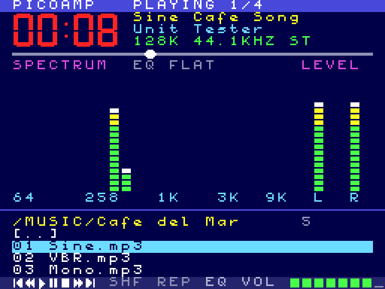
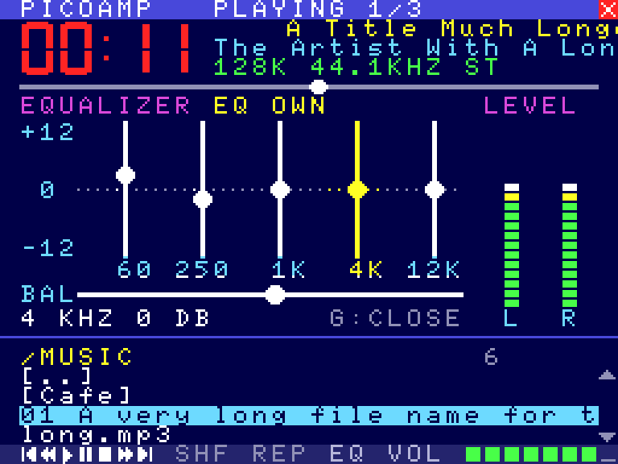

# PICOAMP – MSX-DOS player for the PicoVerse Audio Engine

PICOAMP is a full-screen MP3/WAV and internet radio player for MSX-DOS. It
looks like a mix of Winamp and the MUBScope player. It needs an **MSX2** and a
PicoVerse 2350 cartridge running the PicoPlay firmware (Audio Engine 0.8 or
newer). The engine does the decoding, the equalizer and the sound analysis.
PICOAMP only copies the data and draws it.



| Oscilloscope (V) | Equalizer (G) |
|---|---|
|  |  |

## Running it

```
PICOAMP            start in the root folder of the card
PICOAMP /MUSIC     start in a folder
```

The engine is found by itself in any slot, as PVTEST and PicoPlay do.

## Screen

| Area | What it shows |
|------|---------------|
| Title bar | State (PLAYING / PAUSED / STOPPED), position in the playlist, a close box for the mouse |
| Big digits | Elapsed time |
| Info lines | Title, artist (the station for radio), then bit rate, sample rate and mono/stereo (or "BUFFERING 40%") |
| Seek bar | Position in the track; for radio, how full the buffer is |
| Picture | Spectrum: 24 bars from 60 Hz to 16 kHz on a log scale, 2 dB a step, with falling peak dots. Or the oscilloscope, or the equalizer |
| Level | VU meters, left and right |
| List | The folder or radio list, with the path, the number of entries and page arrows |
| Bottom row | Control icons, SHF / REP (green when on), EQ, volume |

A title, artist, station or file name that is longer than its place stands
still for a second and then scrolls like a news ticker, round and round. One
text moves at a time (the title first, then the artist, then the chosen list
entry), so the rest of the screen stays smooth. Moving through the list gives
the turn to the entry you are on.

The internet radio folders (countries, genres, decades, favourites) work as in
PicoPlay. While the engine fetches a list from the Radio Browser directory,
PICOAMP shows "LOADING THE LIST...".

## Keys

| Key | Action |
|-----|--------|
| Up / Down | Select |
| Left / Right | Page up / down |
| Enter | Open a folder, play a file or a station |
| BS | Parent folder |
| Space | Pause / play |
| S | Stop |
| N / P | Next / previous track |
| + or = / - | Volume |
| , / . | 10 seconds back / forward (files that can seek) |
| H | Shuffle on/off |
| R | Repeat on/off |
| V | Spectrum / oscilloscope |
| G | Equalizer screen |
| E | Next equalizer preset (Flat, Rock, Pop, Jazz, Classic, Voice, Bass, Loud) |
| ESC / Q | Quit to MSX-DOS (the music keeps playing) |

### Equalizer screen

Five sliders (60 Hz, 250 Hz, 1 kHz, 4 kHz, 12 kHz, -12 to +12 dB) and the
left/right balance. The chosen slider is yellow and its value is shown under
the picture.

| Key | Action |
|-----|--------|
| Left / Right | Choose a band, or the balance (the last one) |
| Up / Down | 1 dB up / down (balance: 5 steps right / left) |
| 0 | Back to 0 dB (balance: centre) |
| E | Next preset |
| G / ESC / Enter / BS | Close |

The other playback keys work as well. The engine keeps the setting until the
cartridge is switched off. PicoPlay in SymbOS sets its own saved setting when
it starts.

## Mouse

A mouse in either port is used as soon as it moves. An arrow appears.

* **List:** click an entry to choose it, click it again to open or play it.
  The arrows on the right page up and down. Clicking the path line, or the
  right button, goes to the parent folder.
* **Bottom row:** previous, 10 s back, play, pause, stop, 10 s forward, next,
  SHF, REP, EQ (opens the equalizer), and the volume meter (click where you
  want it).
* **Seek bar:** click to jump there.
* **Picture:** click it or its label to switch spectrum / oscilloscope.
  Clicking the preset name opens the equalizer.
* **Equalizer:** drag a slider or the balance (it snaps to the centre near
  the middle). Clicking the preset name picks the next one, the right button
  closes the screen.
* **Close box** in the title bar: quit.

An empty port (or a joystick) is not taken for a mouse: a mouse is used only
after it has reported standing still once.


## How it works

* SCREEN 4 (MSX2 pattern mode) with the name table set to 0..255 three times.
  Every screen cell gets a pattern of its own, so the screen works like a
  bitmap with two colours per 8-pixel row. Text is the MSX font from the BIOS,
  moved one pixel right. The mouse pointer is two 8x8 sprites (the arrow and
  its shadow). The palette is set by the program and restored on exit.
* Each frame PICOAMP maps the engine into page 1 once, reads the display
  generation and, when the engine has new data, copies its visualisation
  block (`4C00h`: levels, peaks, VU, scope samples). The status block is
  copied only when the display generation has changed. Bars whose level and
  peak did not change are skipped; of the others only the cells between the
  old and the new top are redrawn.
* The oscilloscope and the equalizer are drawn into a 192 x 80 pixel buffer
  in RAM, in the order of the pattern table, so each row of cells goes to the
  VDP in one run. The scope takes its old trace off and puts the new one on,
  then sends the buffer. A change on the equalizer redraws only that slider.
* Tickers shift the font into a row buffer and send only the patterns; the
  colours stay.
* The engine computes the data on core 1 of the RP2350: a 512-point FFT plus a
  second FFT at a quarter of the rate for the low bands. It updates about 50
  times a second. See `pvaudio/pva_viz.c` and the `PVA_VIZ_*` offsets in
  `pvaudio/pva_proto.h`. Any MSX program can read this block.

## Building

```
python3 gen_digits.py > digits.inc      # 7-segment digits (already generated)
python3 gen_tables.py > tables.inc      # scope and buffer tables (already generated)
sjasmplus --nologo --msg=war --raw=PICOAMP.COM picoamp.asm
```

PICOAMP.COM is about 8.5 KB; with its buffers it uses memory up to about 3920h
(page 1 has to stay free for the engine).

### Tests

`test/z80_picoamp.c` runs PICOAMP.COM in a Z80 emulator against the host
build of the Audio Engine (a disk image takes the place of the SD card). It
emulates BDOS keys, the slot BIOS calls, a mouse in port 1 and the VDP, and it
saves VRAM. `test/vram2png.py` turns the saved VRAM into a picture, sprites
included.

```
gcc -O2 -w -I<z80 dir> -o test/z80_picoamp test/z80_picoamp.c <z80 dir>/z80.c libpva_host.a -lm
./test/z80_picoamp PICOAMP.COM card.img "/MUSIC" "}^......}^...." 16 vram.bin font_us.asm
python3 test/vram2png.py vram.bin screen.png
```

Each key in the key string is half a second: `{` up, `}` down, `<` left,
`>` right, `^` Enter, `_` BS, `.` nothing, other characters as they are.
`PICOAMP_MOUSE="t:x,y,b;..."` moves the mouse to (x, y) from t seconds on with
buttons b held (1 left, 2 right). `PICOAMP_DUMP="addr,len;..."` prints memory
at the end. The harness prints how many frames each main loop pass took and
how quickly each key was answered, and how busy the Z80 is and how much it
reads and writes its RAM. On a 3.58 MHz Z80 a pass takes about 1.1 frames
with the spectrum (the Z80 is idle 75% of the time), about 1.5 with the
oscilloscope; equalizer changes are answered in 1-3 frames.
`PICOAMP_PROF=file` writes a profile (program counter samples).

Keeping the Z80 idle matters on the cartridge: in MSX-DOS the main RAM is
the cartridge's 1 MB mapper, in PSRAM behind the same RP2350 cache the
decoder runs from. So PICOAMP draws only what changed, copies the engine's
data only when the engine has new data, and draws the oscilloscope 25 times a
second.

`test/mkimg_picoamp.c` makes a card image with long file names and long tags
(for the tickers). `test/fatput.c` copies files into a card image, for
example PICOAMP.COM into the disk of an openMSX test machine.

## Mock-ups

`mockups/mockup.py` draws the design ideas under the VDP's limits: MSX2
MUBScope/Winamp (built), an MSX1 version of it, and an MSX2 Synthesaurus-style
layout.

## Ideas for later

An MSX1 version, 6-pixel text for longer titles without scrolling, a
favourites key for radio stations, and a peak-hold setting for the spectrum.
